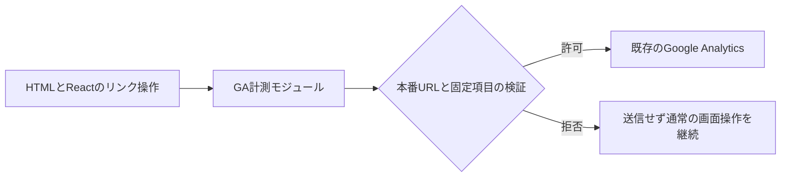

# GA計測と流入導線の改善

- 目的: 開発中の閲覧を除外し、作品・相談への関心を評価できるようにする。
- 承認: 2026-10-27の会話で、計測修正・導線整備・Search Console確認の提案に対するユーザーの「それでお願いします」。push・公開は今回行わない。
- Git: originをfetchし、PR #4のマージ済みmain `566f1a5`を確認。`codex/portfolio-analytics`をその地点から作成。既存ゲームの変更は保持し、stageしない。
- 仕様: `docs/specs/analytics.md`。試験: `docs/tests/functional/analytics.md`、`docs/tests/unit/analytics.md`。
- 手順: 既存の無条件gtagを専用モジュールへ置換。本番URLだけで初期化し、文書全体のクリック委譲でReact描画後のリンクも計測する。作品カードには固定IDだけを追加する。リンク先・媒体パス・レイアウトを維持する。
- 役割: `src/analytics.mjs`はGA送信の入口を所有する。HTML/Reactは掲載内容と作品IDを所有する。送信処理を各コンポーネントへ重複配置しない。
- 同等実装の調査: `gtag|analytics`の検索でindex.htmlの初期化のみ。旧スニペットは削除する。
- 境界: URLのscheme/host/pathを本番の許可範囲と照合。作品ID・リンク分類は固定選択肢のみ。DOMの表示文言・リンクURL・フォーム入力を追加イベントのパラメータへ転記しない。GA取得失敗時も移動を妨げない。
- 入力: locationはURLオブジェクトとして解釈し、不正値・別host・別pathは送信しない。作品IDは許可リスト、リンク分類は固定hostとページ内hashから生成。未知値は計測しない。
- ルール対応: Safety/Security→本番限定送信と固定パラメータ→許可/拒否・失敗試験。Web→クリック/キーボード移動を維持→実ブラウザ確認。Git→既存ゲーム変更の分離→stage差分レビュー。Comments/Design→送信を専用moduleへ集約→独立レビュー。
- 検証: Nodeの単体試験、既存アニメーション試験、Pages build、差分検査、ローカルブラウザでGAタグが挿入されないこととリンク操作の確認。実GAへの新イベント到着は公開後に確認する。
- 依存・DB・権限変更: なし。lint/typecheckは既存設定なし。外部プロフィールの公開編集は準備済みリンクを確認可能にしたうえで実施範囲を明示する。
- リスク: 公開host/path変更時は許可条件も更新が必要。クリックは問い合わせ完了やゲーム起動成功を表さない。戻す場合は本変更をrevertする。

## 結果

- 自動検証: Node 12件成功、Pages build成功、diff check成功。最終修正後も12/12成功、buildとdiff check成功。
- 実画面: 127.0.0.1のプレビューでGoogleタグ0件、全10作品の固定IDと既存リンクを確認。問い合わせへEnterで移動し、#contactと上端約48pxを確認した。
- React確認: react-best-practicesスキルのイベント重複・初期化・描画の観点を適用。既存Reactの状態・effect・リンク構造は変更せず、固定ID属性の追加だけに限定した。
- 独立レビュー: 別エージェントanalytics_reviewがsecurity/data/tests/docs-comments観点で確認。コード上の不具合なし。試験結果未更新の低優先指摘を記録更新で解消した。主担当の自己レビューでも送信情報、旧タグ削除、媒体URLとレイアウトの不変を確認した。
- Comments/Design: isProductionPageのURL拒否、describeLinkの固定分類/null、initializeAnalyticsの副作用・一度だけの初期化を実装とテストに照合。委譲により既存のスムーズスクロールがdefaultPreventedを設定しても計測する。
- Zenn: 会話の導線整備承認に基づき、ウェブサイト欄をポートフォリオのUTM付きURLへ変更。公開プロフィールのDOMで反映確認。自己紹介は維持。画面撮影はCDP timeout、ネイティブ確認もMacロックで失敗し、確認画像は残せなかった。
- Search Console: 現在のログイン先では対象プロパティへのアクセス権なし。権限変更や登録は未実施。公開後のGAイベント実到着も未検証。
- その他の外部プロフィール・記事: 準備済みURLと確認事項をdocs/growth.mdへ記録。Zenn以外の公開編集は未実施。
- lint/typecheckは既存コマンド未設定。既存build警告2件はdocs/known-issues.mdの範囲。依存・DB・Harness/CI設定変更なし。人間のレビュー待ち。
