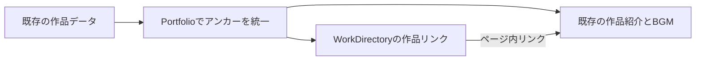

# 作品まで迷わずたどり着けるようにする

## 目的と進め方

作品が増え、BGMやコラボレーションまで縦に探す距離が長くなりました。制作実績の入口に小さな作品ガイドを置き、興味のある紹介へ直接移動できるようにします。

1. 既存データから作品の目次を作ります。
2. Webツール・ゲーム・BGM・コラボレーションの4グループで案内します。
3. Canvaで文字と枠の見せ方を検討し、今の濃紺・シアンの雰囲気へ合わせます。
4. すべてのリンクを実際に操作し、PC・スマホ・キーボードで確かめます。
5. 変更をコミットし、通常PRとレビューの流れでまとめます。

根拠は2026-11-01の会話「計画を立てながら新しい開発を進めて」「canvaでデザインのブラッシュアップ」と、優先項目「作品を見つけやすくする改善」の選択です。実装範囲は会話で上記の作品ガイドとして提示しています。PRの形式とレビュー後のマージは、継続中のポートフォリオ改善に対する直前の依頼を引き継ぎます。

## 変更の範囲

- 基点はmainの5135b51。fetch後のorigin/mainと一致。作業ブランチは既存慣習に合わせた`codex/work-directory`。
- 未コミットの`game/`・`game.html`はユーザーの試作であり、変更・移動・commitしません。
- [仕様](../../specs/work-directory.md)のAC1〜4を[機能試験](../../tests/functional/work-directory.md)で確認します。
- UI visualは既定のB。既存の詳細欄・順序・画像と動画のパス・背景素材を維持します。Canvaは外観の参考に使い、生成画像は配信しません。
- 料金・相談内容、GA、依存、CI、ハーネスは変更しません。既知の遅延読込問題とViteの警告は今回の目次機能に混ぜません。

## 構成と守る契約

`Portfolio.jsx`は既存データの組立を持ちます。ゲームのアンカーをここで一度だけ補い、ガイドと詳細欄へ同じ値を渡します。既存の2アンカーはそのまま、それ以外は`game-<既存id>`です。

新しい`WorkDirectory.jsx`は作品ガイドの表示だけを持ちます。受け取るWeb作品・ゲーム一覧から、通常のリンクを生成します。外部I/Oや状態は持ちません。`GameSection.jsx`は既存の紹介欄を持ち、BGM枠に`<作品アンカー>-music`を付けます。Web作品の紹介欄にも一意のIDを付けます。コラボレーションは既存の`collaboration`を使います。

FT1・2で図のデータ対応と移動を、FT3・4で狭い画面と既存コンテンツの維持を確認します。入力はリポジトリ内の固定データだけで、ユーザー入力をURLにしません。ガイドはReactの通常テキスト描画、リンクは`#`から始まるIDだけです。既存のHTML形式の作品概要をガイドに再利用しません。

同等の目次は検索して存在しないことを確認しました。作品名や楽曲名を別の手書き配列へ転記せず、既存データを正本とします。既存のnavbar・ヒーローからの制作実績リンクはそのままガイドの入口になります。

CSSはガイド専用classに限定し、色は既存変数を使用。内側余白1.25rem、グループ間隔1rem、アンカー上余白5remは仮の調整値として変数にまとめます。2列になる境界は既存と同じ768pxを使います。

## 検証とリスク

既存の解析・アニメーション12test、Pages build、`git diff --check`を実施します。単純なデータの受け渡しとリンク表示なので、実装を写すだけの単体testは追加せず、全リンクの移動とIDの一意性をブラウザで確認します。lint・型検査コマンドは未設定です。

長い作品名、ページ途中リロード、BGMへの直接移動、キーボードfocus、390pxと1280pxの表示を確認します。既存の画像・動画パスと掲載データは差分で確認します。障害時はガイド追加のcommitを戻すことで、従来の詳細表示に戻せます。

## 実装・検証の結果

Canva参考案`DAHZoVlstNQ`の1ページ目を確認しました。細い枠で4グループを区切り、シアンで操作を示す考え方を採用。見本の縦一列の構成やアイコンはそのまま取り込まず、PCは2列・スマホは1列で既存の詳細欄の手前に追加しました。矢印はページ内移動に合わせて下向きとしています。

AC1〜4の機能試験は成功。既存12test・Pages build・差分空白検査も成功し、既知のVite警告は継続しています。掲載データとメディアのパスは変更していません。コードの責務・コメントを照合し、WorkDirectoryはリンクの表示、Portfolioはアンカーの組立、GameSectionは紹介先IDの指定だけを担当することを確認しました。新しい状態・外部通信・危険なHTML描画はありません。範囲外の新しい課題はありません。
